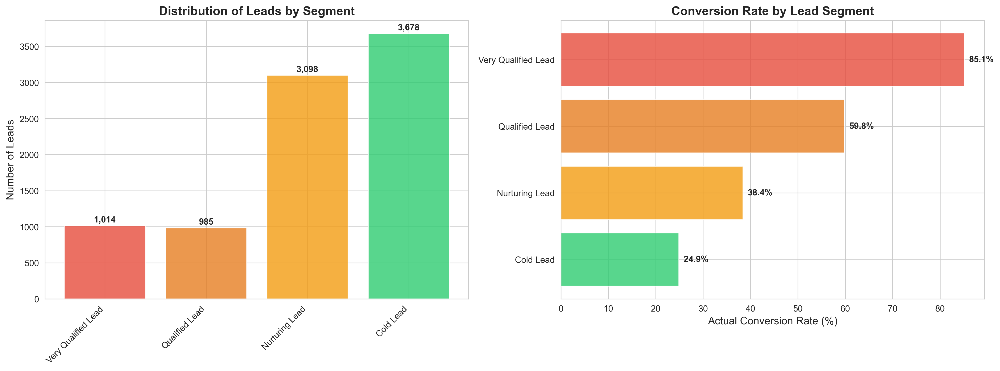

# Lead Scoring: Which Leads Are Worth Sales Time?
 
**Marketing analytics · Lead scoring · Funnel and channel quality**
 
A lead scoring model and funnel analysis on 9,240 leads from an online education company ([public Kaggle dataset](https://www.kaggle.com/datasets/ashydv/leads-dataset)). 38.5% of the leads became customers. The goal: score every lead, find out why so many never convert, and turn that into concrete actions for marketing, CRM and sales.
 

 
---
 
## 🔎 What the data shows
 
**Where leads come from matters more than how many there are.**
- Leads from referrals convert at 92%, while leads from the website chat (Olark) convert at only 25.5%, against 38.5% on average.
- Google brings the most leads (2,868) and converts at 40%, so the issue there is targeting, not volume.
**Completing the form is the strongest signal of intent.**
- Leads with a complete form convert at 48.9%, against 13.8% for incomplete ones.
**Time on the website beats the number of visits.**
- Leads who convert spend more than twice as long on the site (about 12 minutes against 5.5), while visits and page views say much less.
**Data quality hides part of the picture.**
- 29% of leads miss key profile fields, and many "Select" values are form defaults rather than real answers. Telling those apart was the first cleaning step.
---
 
## 🎯 The scoring model
 
XGBoost, compared against a Random Forest, on an 80/20 split:
 
| Measure | Result |
|---|---|
| ROC-AUC | 0.925 |
| Accuracy | 85.6% |
| Precision | 83.6% |
| Recall | 80.2% |
 
Each lead gets a score from 0 to 100, grouped into four segments:
 
| Segment | Score | Conversion |
|---|---|---|
| Very qualified | 75 to 100 | 85.1% |
| Qualified | 50 to 75 | 59.8% |
| Nurturing | 25 to 50 | 38.4% |
| Cold | 0 to 25 | 24.9% |
 
42% of leads (3,678) land in the Cold segment.
 
---
 
## 📬 What this means for CRM and marketing
 
- **Route by segment.** Sales calls the very qualified and qualified leads first. Cold leads go to an automated nurture journey instead of a call.
- **Build a nurture journey for the middle.** Nurturing leads convert at 38%: worth a sequence of emails and content, not worth chasing by phone.
- **Fix the form before buying more traffic.** Making key fields mandatory and simplifying the form improves both conversion and data quality.
- **Qualify chat leads.** Add qualifying questions to the website chat, or limit it, since most of its leads are cold.
- **Tighten Google targeting.** Same budget, fewer cold leads.
### Estimated impact
 
This is an estimate, not a measured result. Assuming **30 minutes of sales time per cold lead** and **$50 per hour**, the 3,678 cold leads in the dataset represent about **1,840 sales hours, or roughly $92,000**. The dataset has no dates, so this is for the leads in the file, not per year.
 
---
 
## ⚠️ Limitations
 
- **One company, one snapshot.** No dates, so no trends or seasonality.
- **Some inputs are recorded after the first contact.** Sales tags and lead quality ratings are filled in by the sales team, so they make the model look stronger than it would be on a brand-new lead. For live scoring at signup, the model should be retrained without them.
- **The cost figures rest on the assumptions above.** Swap in real sales costs before using them.
---
 
## 🛠️ How it was built
 
| Notebook | What it does |
|---|---|
| `00_data_cleaning.ipynb` | Data quality checks, separating form defaults from missing data, outliers |
| `01_data_exploration.ipynb` | Conversion by channel, form completion, behaviour and sales status |
| `02_lead_scoring_model.ipynb` | Random Forest and XGBoost, scoring and segmentation |
| `03_implementation_plan.ipynb` | Recommendations and roll-out plan |
 
Also in the repo: `sql_queries/` with sample CRM queries for lead extraction and funnel analysis, and `visualizations/` with the charts.
 
**Stack:** Python, pandas, scikit-learn, XGBoost, Matplotlib, Seaborn, SQL
 
### Run it
 
```bash
git clone https://github.com/clairedebadts-cloud/b2b-lead-scoring-analytics.git
cd b2b-lead-scoring-analytics
python -m venv venv && source venv/bin/activate
pip install -r requirements.txt
jupyter notebook
```
 
Then run the notebooks in order, from `00` to `03`.
 

---

## 🙏 Data Source

Dataset: [Kaggle - Leads Dataset](https://www.kaggle.com/datasets/ashydv/leads-dataset)

